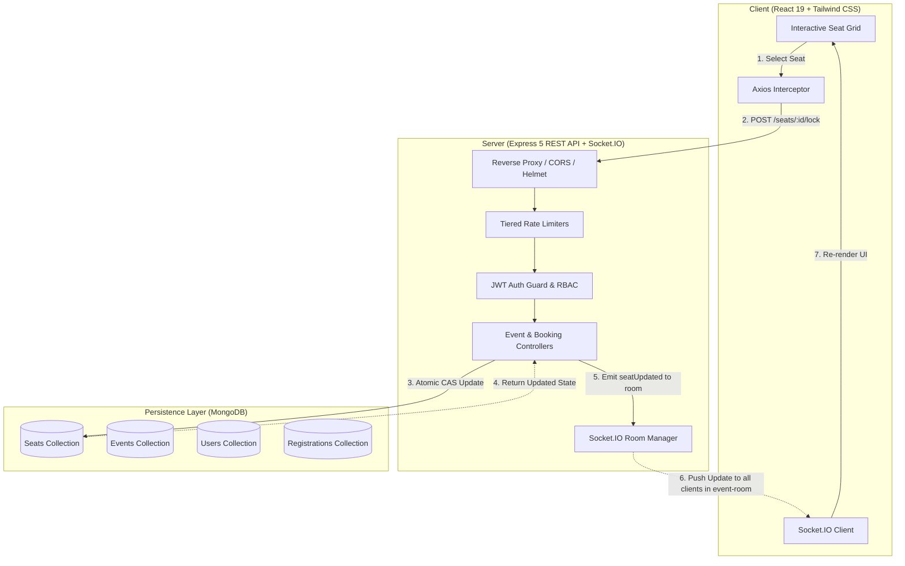
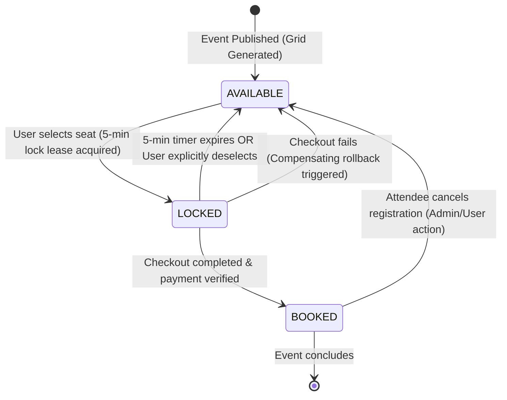

<!-- PROJECT LOGO / HEADER -->
<div align="center">
  

  <p align="center">
    <strong>A high-concurrency event management and ticketing platform engineered to eliminate double-booking using atomic database operations and sub-second WebSocket synchronization.</strong>
  </p>

  <p align="center">
    <a href="https://github.com/indrajithas673/event-booking-system/blob/main/LICENSE"></a>
    <a href="https://nodejs.org/"></a>
    <a href="https://expressjs.com/"></a>
    <a href="https://www.mongodb.com/"></a>
    <a href="https://socket.io/"></a>
    <a href="https://react.dev/"></a>
  </p>

  <p align="center">
    <a href="#-key-highlights">Key Highlights</a> •
    <a href="#-architecture--concurrency">Architecture</a> •
    <a href="#-seat-state-machine">Seat State Machine</a> •
    <a href="#-system-limits--thresholds">Engineering Metrics</a> •
    <a href="#-role-based-features">Feature Matrix</a> •
    <a href="#-api-documentation">API Reference</a> •
    <a href="#-quick-start-guide">Quick Start</a>
  </p>
</div>

<br />

---

## ⚡ The Concurrency Challenge & The Solution

> **The Problem:** In high-demand flash ticket drops (concerts, conferences, sports), thousands of users select and confirm seats within milliseconds of each other. Traditional database transactions often experience deadlocks or race conditions, resulting in the dreaded **double-booking bug** where two customers pay for the exact same seat.
>
> **The Solution:** This engine combines an **Atomic Compare-And-Swap (CAS)** pattern on MongoDB with **5-minute timed lock leases** and **isolated WebSocket broadcast rooms**. When a user selects a seat, it is atomically locked across the entire cluster; all other users viewing that event immediately see the seat grayed out in real time without refreshing their browser.

```
+---------------------------------------------------------------------------------------------------+
|                                  RACE CONDITION PREVENTION FLOW                                   |
|                                                                                                   |
|  User A (Selects A1) ---> [ Atomic Lock: findOneAndUpdate ] ---> Success ---> Broadcast Locked   |
|                                         |                                                         |
|  User B (Selects A1) ---> [ Atomic Lock: findOneAndUpdate ] ---> Rejected ---> "Already Locked"   |
|                                                                                                   |
|  User A Checks Out   ---> [ State Transition: BOOKED ]      ---> Confirmed Ticket + QR Issued     |
|  User A Abandons     ---> [ TTL Timer (300s) Expires ]     ---> Auto-Reverted to AVAILABLE       |
+---------------------------------------------------------------------------------------------------+
```

### ⚔️ What Happens When Two People Click the Same Seat at the Same Millisecond?

When **User A** and **User B** attempt to select and reserve the exact same seat simultaneously:

1. **Both HTTP Requests Hit the Backend in Parallel:**
   * Both clients send `POST /api/events/:eventId/seats/:seatId/lock` at nearly the exact same time.

2. **MongoDB Enforces Document-Level Serialization (Atomic CAS):**
   * MongoDB processes writes to an individual seat document sequentially using internal write locks.
   * Both operations execute the atomic conditional query:
     ```javascript
     Seat.findOneAndUpdate(
       {
         _id: seatId,
         $or: [
           { status: 'AVAILABLE' },
           { status: 'LOCKED', lockedUntil: { $lt: new Date() } }
         ]
       },
       { status: 'LOCKED', lockedBy: userId, lockedUntil: lockExpiry },
       { new: true }
     )
     ```

3. **User A (The Winner by Microseconds):**
   * Arrives first; the document evaluates `{ status: 'AVAILABLE' }` as `true`.
   * MongoDB atomically writes `status: 'LOCKED'`, assigns `lockedBy: User_A_ID`, and sets `lockedUntil` to 5 minutes in the future.
   * The server responds with `HTTP 200 OK`, returning the locked seat payload and triggering a live 5-minute checkout countdown in User A's browser.

4. **User B (The Loser — Handled Gracefully):**
   * Arrives microseconds later; the seat status is now `'LOCKED'` with an unexpired lease.
   * The query condition evaluates to `false`, matching **0 documents** and returning `null`.
   * The server intercepts this and immediately returns `HTTP 400 Bad Request` with the message:
     ```json
     { "success": false, "message": "Seat is already locked or booked by someone else" }
     ```
   * User B's UI displays an instant toast notification: *"Seat is already locked or booked by someone else"*, preventing any inconsistent state.

5. **Sub-Second Real-Time Synchronization:**
   * Upon User A's successful lock, the server broadcasts a `seatUpdated` payload to the Socket.IO room `event-${eventId}`.
   * User B's seat map (and every other connected user's map in that venue) instantly flips that seat to yellow/gray (locked) in real time without refreshing.

---

## 🌟 Key Highlights

* **💺 Real-Time Interactive Seat Grid:** Dynamically generates seat layouts from custom row and column configurations ($R \times S$) with sub-second visual updates.
* **⏱️ 5-Minute Atomic Lease Engine:** Temporary seat reservation with automatic expiration if checkout is abandoned, preventing seat hoarding.
* **⚡ Isolated WebSocket Rooms:** Socket.IO scoped channels (`event-${eventId}`) broadcast state changes strictly to attendees viewing that specific venue, eliminating redundant network overhead.
* **🎟️ QR Code Digital Ticketing:** Generates scannable, cryptographically unique 12-character alphanumeric tokens for swift on-site attendee check-in.
* **🛡️ Hardened Security Perimeter:** Multi-tiered IP rate limiting, account lockout on consecutive failed attempts, Content Security Policy (Helmet), and MongoDB sanitization against NoSQL injection.
* **📊 Role-Based Dashboards:** Dedicated operational interfaces for **Attendees**, **Organizers** (capacity utilization, revenue analytics, check-in portal), and **Admins** (system-wide user, event, and moderation controls).
* **📖 Interactive Swagger Documentation:** Full OpenAPI 3.0 specification available out of the box at `/api-docs`.

---

## 🛠️ Technology Stack

| Layer | Technologies |
| :--- | :--- |
| **Frontend** | React 19, Vite, Tailwind CSS v4, Socket.IO Client, Axios, React Router DOM v7, React Hot Toast, QRCode.react, Date-fns |
| **Backend** | Node.js (v18+), Express 5, Socket.IO v4, Swagger UI, Multer (Memory Storage) |
| **Database** | MongoDB, Mongoose 9 (Compound Unique Constraints & Atomic CAS) |
| **Security & Middleware** | JSON Web Tokens (JWT), Express Rate Limit, Helmet (CSP), Express Mongo Sanitize, Morgan Logging |

---

## 🏗️ Architecture & Concurrency

The system follows an asynchronous, decoupled client-server architecture with an integrated real-time pub/sub event layer.



---

## 🔄 Seat State Machine

Every individual seat transitions through strict lifecycle states protected by atomic database queries and compensation logic:



### State Definitions:
1. **`AVAILABLE`:** Open for any attendee to reserve.
2. **`LOCKED`:** Reserved by an attendee for exactly 300 seconds (`Date.now() + 5 * 60 * 1000`). Other users cannot select this seat.
3. **`BOOKED`:** Confirmed registration tied to a persistent ticket record and confirmation code.
4. **`COMPENSATION HOOK`:** If registration record persistence fails mid-flight, an automatic rollback restores the seat status to `AVAILABLE` and adjusts capacity counters.

---

## 📊 System Limits & Engineering Thresholds

The application is configured with robust defensive thresholds to ensure system reliability and resilience:

| Category | Parameter / Metric | Threshold / Value | Rationale |
| :--- | :--- | :--- | :--- |
| **Concurrency** | Seat Reservation TTL | **5 minutes (300,000 ms)** | Limits checkout window and releases idle seats |
| **Rate Limiting** | Global API Tier | **100 req / 15 min** | Protects server against request flooding |
| **Rate Limiting** | Auth Endpoints | **10 req / 15 min** | Defends against brute-force & credential stuffing |
| **Rate Limiting** | Event Registration | **20 req / 15 min** | Stops automated ticket-sniping bots |
| **Rate Limiting** | Ticket Code Verification | **20 req / 15 min** | Throttles unauthorized confirmation lookups |
| **Brute Force** | Account Lockout Threshold | **5 failed attempts** | Locks account to prevent dictionary attacks |
| **Brute Force** | Account Lockout Duration | **15 minutes (`423 Locked`)** | Cool-off window before retrying credentials |
| **Payload** | JSON & URL-Encoded Cap | **10 KB max body size** | Prevents memory allocation denial-of-service |
| **Network** | Frontend Request Timeout | **15,000 ms (15s)** | Axios interceptor drops hanging connections |
| **Network** | Search Debounce Delay | **300 ms** | Eliminates rapid backend regex and database churn |
| **Scale** | Event Venue Capacity | **1 to 100,000 attendees** | Supports small workshops to stadium-scale arenas |
| **Scale** | Max Tickets Per User | **1 to 10 seats** (default: 1) | Prevents bulk seat accumulation by single users |
| **Security** | Confirmation Code Entropy | **12 alphanumeric chars** | Unique uppercase identifier generated via UUID |

---

## 👥 Role-Based Features

The platform enforces strict Role-Based Access Control (RBAC) across three distinct roles:

```
+----------------------------------------------------------------------------------------------------+
|                                    ROLE PRIVILEGE MATRIX                                           |
|                                                                                                    |
|  Capability                             Attendee              Organizer               Admin        |
|  ------------------------------------------------------------------------------------------------- |
|  Browse & Search Events                    ✅                     ✅                    ✅         |
|  Interactive Seat Booking & Locks          ✅                     ✅                    ✅         |
|  Digital QR Ticket Management              ✅                     ✅                    ✅         |
|  Cancel Own Registrations                  ✅                     ✅                    ✅         |
|  Create & Publish Events                   ❌                     ✅                    ✅         |
|  Custom Matrix Grid Builder                ❌                     ✅                    ✅         |
|  Live Attendee Check-In Scanner            ❌                     ✅                    ✅         |
|  Revenue & Capacity Analytics              ❌                     ✅                    ✅         |
|  Global User Management & RBAC             ❌                     ❌                    ✅         |
|  System-Wide Health & Deactivations        ❌                     ❌                    ✅         |
+----------------------------------------------------------------------------------------------------+
```

### 🎟️ Attendee Experience
* Search and filter events by category, date range, pricing, and city.
* Visual seat picker with live status indicators (Available, Locked, Booked, Your Selection).
* Countdown timer alerting the buyer to complete checkout before lease expiration.
* Ticket dashboard featuring live scannable QR codes for event check-in.

### 🏢 Organizer Studio
* Visual venue builder: configure rows and seats-per-row with instant capacity calculation.
* Manage event lifecycles through Draft, Published, and Cancelled stages.
* Real-time check-in interface verifying attendees via 12-character ticket codes or QR scans.
* Financial metrics: track gross revenue estimates, ticket velocity, and capacity utilization.

### 🛡️ Admin Command Center
* Global dashboard reporting total user breakdown, monthly acquisition, and top-performing events.
* User administration: promote/demote roles (`attendee`, `organizer`, `admin`) and toggle active account status.
* Safeguards preventing the deletion or demotion of the final administrator account.

---

## 📡 API Documentation

Interactive Swagger documentation is available locally at `http://localhost:5000/api-docs`.

### Core Endpoint Summary

#### 🔐 Authentication (`/api/auth`)
* `POST /api/auth/register` — Register a new account (`attendee` or `organizer`)
* `POST /api/auth/login` — Authenticate and receive signed JWT (monitored for lockout)
* `GET  /api/auth/me` — Retrieve authenticated user profile
* `PUT  /api/auth/profile` — Update account profile details
* `PUT  /api/auth/change-password` — Change password and invalidate prior sessions
* `DELETE /api/auth/delete-account` — Delete account and cascade-remove registrations

#### 🎪 Events (`/api/events`)
* `GET    /api/events` — Paginated catalog with filtering (category, price, date, city, search)
* `GET    /api/events/featured` — Top 6 featured upcoming events
* `GET    /api/events/categories` — Aggregated category counts
* `GET    /api/events/:slug` — Retrieve single event details by URL slug
* `POST   /api/events` — Create event draft and initialize seat grid *(Organizer/Admin)*
* `PUT    /api/events/:id` — Update event parameters *(Organizer/Admin)*
* `PUT    /api/events/:id/publish` — Validate and publish draft event *(Organizer/Admin)*
* `PUT    /api/events/:id/cancel` — Cancel published event *(Organizer/Admin)*
* `DELETE /api/events/:id` — Delete event if zero active bookings exist *(Organizer/Admin)*

#### 💺 Seats & Concurrency (`/api/events/:eventId/seats`)
* `GET  /api/events/:eventId/seats` — List all seats with current lock and booking statuses
* `POST /api/events/:eventId/seats/:seatId/lock` — Acquire 5-minute atomic lock lease
* `POST /api/events/:eventId/seats/:seatId/unlock` — Release an active lock lease

#### 📝 Registrations (`/api/registrations` & `/api/events/:id/register`)
* `POST   /api/events/:id/register` — Finalize booking for locked seat
* `GET    /api/registrations/my` — View current user's tickets (paginated)
* `GET    /api/registrations/:id` — Inspect individual ticket details
* `GET    /api/registrations/code/:code` — Lookup registration by 12-char ticket code
* `DELETE /api/registrations/:id` — Cancel registration and restore seat availability
* `PUT    /api/registrations/:id/check-in` — Check in attendee *(Organizer/Admin)*

#### 🛠️ System & Diagnostics
* `GET /api/health` — Returns API operational status and server timestamp

---

## 🚀 Quick Start Guide

### Prerequisites
* **Node.js** (v18.0.0 or higher)
* **npm** (v9.0.0 or higher)
* **MongoDB** (Local instance or MongoDB Atlas URI)

---

### Step 1: Clone the Repository
```bash
git clone https://github.com/indrajithas673/event-booking-system.git
cd event-booking-system
```

---

### Step 2: Configure Environment Variables

Create `.env` inside the `server/` directory:
```bash
cd server
cp .env.example .env
```

Edit `server/.env` with your settings:
```env
# Server Configuration
PORT=5000
NODE_ENV=development

# Database Connection
MONGO_URI=mongodb://localhost:27017/event-booking

# Authentication & Security
JWT_SECRET=your_super_secret_jwt_key_at_least_32_characters_long
JWT_EXPIRE=7d

# Client URL (for CORS validation)
CLIENT_URL=http://localhost:5173

# File Upload Threshold
UPLOAD_MAX_SIZE=5242880

# Optional: Initial Admin Seed Credentials
ADMIN_SEED_EMAIL=admin@eventbooking.local
ADMIN_SEED_PASSWORD=AdminPassword123!
ADMIN_SEED_NAME="System Administrator"
```

---

### Step 3: Install Dependencies

#### Server:
```bash
cd server
npm install
```

#### Client:
```bash
cd ../client
npm install
```

---

### Step 4: Seed Sample Data (Optional)

Populate the database with an admin user and realistic sample events across multiple categories:
```bash
cd ../server
npm run seed
```

---

### Step 5: Start Development Servers

Launch both backend and frontend concurrently:

#### Terminal 1 — Backend API:
```bash
cd server
npm run dev
# Server running at: http://localhost:5000
# API Docs available: http://localhost:5000/api-docs
```

#### Terminal 2 — Frontend Application:
```bash
cd client
npm run dev
# Vite client running at: http://localhost:5173
```

---

## 🧠 Design Decisions & Trade-Offs

| Architectural Choice | Why We Did It | Trade-Off & Future Evolution |
| :--- | :--- | :--- |
| **Normalized Seat Model** | Individual documents per seat enable atomic CAS updates, unique compound indexing, and independent TTL expiry. | Higher collection document volume; mitigated by efficient compound indexing `{ event: 1, seatNumber: 1 }`. |
| **Native Atomic CAS vs. Heavy Distributed Locks** | Leveraging MongoDB's atomic `findOneAndUpdate` with conditional queries eliminates the dependency on Redis for core locking. | Scoped to single-document updates; supported by application-level compensating rollback transactions on checkout failure. |
| **Room-Scoped WebSockets** | Isolating Socket.IO connections to specific `event-${id}` channels ensures updates only travel to active shoppers. | Currently runs in-memory; scaling horizontally across multiple Node clusters would introduce a Redis Pub/Sub adapter. |
| **Client Inactivity & Lock Expire** | Server-side timestamps (`lockedUntil`) guarantee that even if a user closes their tab, the seat releases automatically. | Requires client-side countdown timer synchronization with server clock. |

---

## 📄 License

This project is licensed under the **MIT License** — see the [LICENSE](LICENSE) file for complete details.

---

<div align="center">
  <p>Engineered with precision by <a href="https://github.com/indrajithas673"><strong>Indrajith</strong></a></p>
  
</div>
